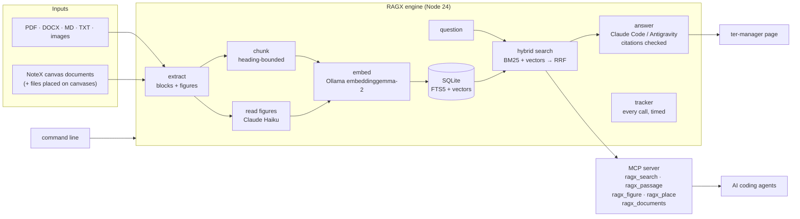

# RAGX

**A private, local-first RAG engine: your documents in, answers out, with every statement cited back to the page it came from.**


RAGX reads your PDFs, Word files, Markdown, text files and images, and answers questions about them. Each answer cites the passages and figures it used, and those citations are checked before you see them. Documents and search stay on your machine; only the question and the passages it found go to the answering model. RAGX works three ways:

- **as a page** inside ter-manager, a desktop app that hosts plugins, with a library, chat, a live tracker and settings;
- **as a command-line tool** (`npm run rag -- …`);
- **as an MCP server**, so AI coding agents such as Claude Code can search your documents themselves.

It also reads **File Fabric / CanvasX canvases** (through **NoteX**). A canvas becomes a document that keeps its layout, so an answer can say *where* on your canvas something is, not just what it says.

---

## Why this was hard

A demo RAG is about 50 lines: split the text, embed it, find the nearest chunks. RAGX is built for real documents on a modest laptop (8 GB RAM), with no cloud database and almost no dependencies. Most of the work went into these problems:

| Problem | What RAGX does |
|---|---|
| **A PDF has no paragraphs**, only glyphs at coordinates | Rebuilds lines, paragraphs and headings from where the text sits on the page (font size, gaps, letter-spacing). The rules were tuned against real multi-page reports. |
| **Charts in PDFs are not images**, but vector shapes drawn on the page | Finds figures by following the page's drawing operations through their transforms and grouping marks that touch, then renders and crops each figure. On a 23-page report it found all 6 captioned figures and none of its tables. |
| **Images contain text that embeddings can't read** | Claude Haiku transcribes each figure and scanned page once, and the reading is stored and embedded. It reads two at a time with one spare reader started ahead (at most three Claude processes, sized for ~1.4 GB of free RAM), and never reads the same figure twice. |
| **Vector search misses exact words; keyword search misses meaning** | Hybrid search: SQLite FTS5 (BM25) and vector search each take their best 40, merged by reciprocal rank fusion. Figures are searched in the same embedding space as text. |
| **Chunks that cut across sections lose their context** | Chunks never cross a heading and carry their full heading path. Prose is packed by sentence, code by line and tables by row (with the header repeated). Overlaps are recorded so neighbouring chunks can be joined without repeating text. |
| **Reading Word files without a library** | A hand-written ZIP reader and streaming XML walker for `.docx`. It understands heading styles, outline levels and inherited styles, and skips tracked deletions and field codes. |
| **Answers that cite things they didn't see** | The engine, not the model, does the searching. Passages are numbered as sources, the model may only cite those numbers, and every citation is checked. In a conversation a source keeps its number across follow-ups. |
| **Documents change** | A new version of a file can replace the old document. A follow-up is told which earlier sources came from the old version. Document, passage and figure ids are never reused, with a database migration for existing libraries. |
| **Local models eat RAM and GPU** | The engine starts Ollama if needed, stops only the Ollama it started, unloads its model on exit, and limits open agent sessions (at most 2, closed after 10 min idle). |
| **A local server is reachable by any web page** | Loopback only, and every request must pass three checks: a per-start token header (which forces a CORS preflight), the host page's origin, and the `Host` header. |

---

## Architecture



**Ingest:** file → copy → extract → chunk → embed → ready. Each step is recorded, so `resume` finishes what an interrupted run left half-done.

**Ask:** question → hybrid search → numbered sources → headless agent (Claude Code or Google Antigravity, on the user's own subscription, with tools off and API keys removed from its environment) → citations checked → answer with clickable sources and figures.

---

## Features

**Library**
- Add PDF, DOCX, Markdown, text and image files. A file named like an existing document can replace it as a new version.
- Figures (charts, diagrams, pictures, scanned pages) are cropped, stored, read by Claude Haiku and searchable by description.
- File Fabric canvases are kept apart from ordinary files. When a canvas is updated, only its changed places are re-embedded.
- Files placed on a canvas come in as documents that remember where they sit, with an "On <canvas>" badge and their place shown in every source.

**Ask**
- Cited answers in conversations. Follow-ups resume the same agent session instead of resending the history.
- Limit a conversation to the documents you tick.
- Cited figures are shown under the answer, full size on click.

**For agents (MCP)**

| Tool | What it gives the agent |
|---|---|
| `ragx_search` | best passages and figures for a question |
| `ragx_passage` | one passage with the text around it |
| `ragx_figure` | the figure image itself |
| `ragx_documents` | the library, with where each canvas file sits |
| `ragx_place` | moves around a canvas place by place: what holds it, what it holds, its neighbours and links (a few hundred tokens a step) |

If the engine isn't running, the agent's call shows up as a request in the page's Notifications tab; **Approve** starts the engine.

**Tracker**
- Every call (from the page, an agent or the CLI) is recorded with its question, its results, and how long embedding, model loading, search and answering each took, plus what the GPU was doing. Updates live.

**Settings**
- Embedding model (any Ollama model; `reembed` rebuilds every vector), answering agent and model, figure reading on/off and its model.

---

## Tech stack

- **Node.js 24**, plain ES modules, no framework
- **node:sqlite** (built into Node): FTS5 full-text search, BM25 ranking, vectors stored as BLOBs
- **Ollama** with `embeddinggemma-2:440m` for text and image embeddings, in one shared space
- **Claude Code** (headless) and **Google Antigravity CLI** as answering agents; **Claude Haiku** as the figure reader
- **pdf.js** (`pdfjs-dist`) and `@napi-rs/canvas`, the only two runtime dependencies
- **MCP** server written by hand: JSON-RPC 2.0 over stdio
- Plugin page in vanilla HTML/CSS/JS

## By the numbers

| | |
|---|---|
| Engine and page source | ~8,800 lines |
| Tests | 204 (199 run offline; 5 live tests need Ollama models) in ~4,000 lines |
| Runtime dependencies | 2 |
| Commits | 45, each explaining *why* |
| Database schema | version 7, with migrations for existing libraries |

---

## Getting started

### Requirements
- Node.js **24 or newer** (for `node:sqlite`)
- [Ollama](https://ollama.com) with the embedding model: `ollama pull embeddinggemma-2:440m`
- For answers and figure reading: [Claude Code](https://claude.com/claude-code) logged in, or the Antigravity CLI (`agy`)

### Install and test
```bash
npm install
npm test
```

### Command line
```bash
# --data-dir is required: you decide where the library lives
npm run rag -- --data-dir ./library ingest report.pdf notes.docx
npm run rag -- --data-dir ./library search "what was the Q3 revenue?"
npm run rag -- --data-dir ./library ask "summarise the findings" --agent claude
npm run rag -- --data-dir ./library list
npm run rag -- --data-dir ./library serve   # the engine on 127.0.0.1:7780, for the page and MCP
npm run rag -- --help          # every command
```

### As a ter-manager plugin
```bash
npm run rag -- plugin-setup     # once: tells the page where the engine is
```
Then register the `plugin/` folder in ter-manager. (ter-manager is not public yet; see *Runs inside ter-manager* below.) The page starts and stops the engine (on `127.0.0.1:7780`) itself.

### For Claude Code (MCP)
```bash
claude mcp add --scope user ragx -- node "<path to this repo>/engine/mcp.js"
```

---

## Project layout

```
engine/
  cli.js              command-line tool
  mcp.js              MCP server for coding agents
  lib/
    extract/          PDF, DOCX (own ZIP + XML reader), Markdown, text, images, figure finding
    chunk.js          heading-bounded chunking
    embed.js          Ollama embeddings, model read from /api/show
    db.js, store.js   SQLite schema, migrations, all SQL in one place
    vectors.js        in-memory exact vector search
    search.js         hybrid search with reciprocal rank fusion
    answer.js         cited answers and conversations
    agents/           headless Claude Code and Antigravity, session pool
    reader.js         figure reading with Claude Haiku
    server.js         loopback HTTP server for the page
    tracker.js        call and GPU tracking
    notex.js, place.js  File Fabric canvases from NoteX
plugin/               the ter-manager page
test/                 node:test suites with fake Ollama and fake agents
```

## Runs inside ter-manager

ter-manager is my own terminal and workspace manager that hosts plugins like this one; it is not public yet. Without it, everything still works from the command line: start the engine with `serve` and use the CLI or the MCP server.

RAGX is a **ter-manager plugin**. Its page (`plugin/`) opens in ter-manager's sidebar as **RAGX — Ask your files**, and ter-manager gives it a data folder of its own. The page starts and stops the engine on `127.0.0.1:7780` itself. It talks to the engine through ter-manager's plugin protocol, and the engine accepts requests only from that page. The command line and the MCP server use the same engine, so the page, the terminal and AI agents all see the same data.

## GitX ready

This repository is set up for the **GitX workflow**, so any AI coding agent that opens it works the same disciplined way:

- `AGENTS.md` holds the instructions once; `CLAUDE.md` and `GEMINI.md` import it, so **Claude Code** and **Google Antigravity** both follow it.
- The `gitx-workflow` skill ships in `.claude/skills/` and `.agents/skills/`, and a hook in `.claude/settings.json` checks the workflow after every edit and at the end of each turn, when GitX is installed on the machine (without it, the hook stays silent).
- Agents catch up on recorded decisions before changing anything, record new decisions, rejected alternatives and costs as they happen, cite them in code comments by id, and commit with GitX trailers (`GitX-Builds-On`, `GitX-Thoughts`, …).
- Each commit message carries its GitX trailers, so the reasoning behind every change travels with the code; the full decision record stays private in `.gitx/`.

## How it was built

Every design decision, rejected alternative and accepted cost is recorded with **GitX**, my own decision-record workflow, while the work happens. The ids you see in code comments (for example `t-c6c48895e7` beside the hybrid search) point to those records. Each commit message explains why the change was made, not only what changed. Run `git log` to follow the whole design.

## Related projects

- **NoteX** turns File Fabric / CanvasX canvases into documents RAGX can search, and lets agents write on canvases.
- **CanvasX** is the infinite canvas app itself.

## License

Copyright (C) 2026 Paveen Pratheek.
RAGX is free software under the **GNU Affero General Public License v3 or later**. See [LICENSE](LICENSE) and [NOTICE](NOTICE). The name "RAGX" is not licensed for use by modified versions.
